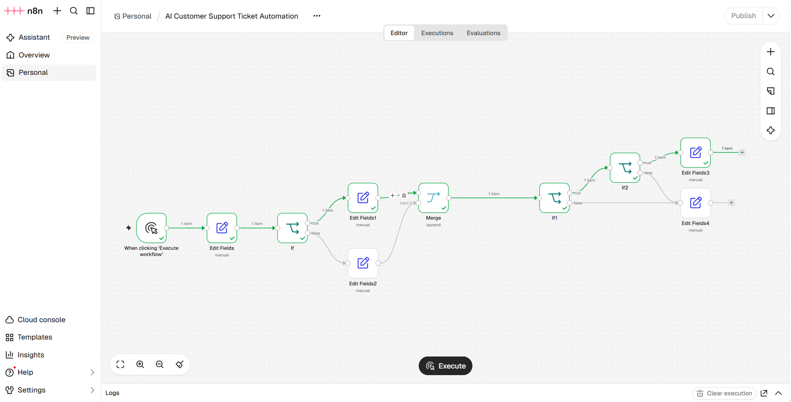

# AI Customer Support Ticket Automation

**Author:** Ahmad Ballout  
**Category:** Workflow Automation  
**Platform:** n8n

## Overview

This project demonstrates a customer support ticket classification workflow built with n8n. It evaluates incoming ticket information and assigns a priority and category using configurable conditions.

The workflow uses sample ticket data and a manual trigger, making it easy to test and demonstrate without connecting to a live customer support system.

## Objectives

- Automatically classify support tickets by urgency.
- Assign a priority of `High` or `Normal`.
- Categorize tickets as `Account Access` or `General Support`.
- Preserve the original ticket information throughout the workflow.
- Demonstrate conditional logic and branching in a visual automation platform.

## Workflow Logic

1. **Manual Trigger:** Starts the workflow when a user executes it.
2. **Edit Fields — Sample Ticket:** Supplies the customer name, email, subject, and message.
3. **IF — Urgency Check:** Checks whether the message contains the word `urgent`.
4. **Priority Assignment:** Assigns `High` for matching messages and `Normal` otherwise.
5. **Merge:** Reunites the two priority branches.
6. **IF — Category Check:** Checks whether the subject contains the word `account`.
7. **Category Assignment:** Assigns `Account Access` when the condition matches, or `General Support` otherwise.

## Example Results

| Example | Priority | Category |
|---|---|---|
| “Unable to access my account” with an urgent message | High | Account Access |
| “Question about contact information” with a non-urgent message | Normal | General Support |

These results were tested in n8n using sample data.

## Tools and Concepts

- **n8n:** Visual workflow automation platform.
- **Manual Trigger:** Starts a workflow on demand.
- **Edit Fields:** Creates and updates ticket fields.
- **IF nodes:** Routes data according to conditions.
- **Merge node:** Combines the outputs of alternative branches.

## How to Import and Test

1. Install or access an n8n instance.
2. Open the workflow editor.
3. Choose the option to import a workflow from a file.
4. Select `ai-customer-support-ticket-automation.json`.
5. Review the nodes and sample ticket values.
6. Execute the workflow manually.
7. Inspect the final output to verify the priority and category.

Node labels and menu locations may vary by n8n version.

## Limitations

- The workflow uses manually supplied sample data.
- It does not currently connect to an email inbox, ticketing platform, or CRM.
- Classification is based on simple keyword checks rather than AI-based intent detection.
- Messages containing `urgent` are assigned high priority even if the context does not truly indicate urgency.
- The workflow is a demonstration and should be extended and tested before production use.

## Future Improvements

- Integrate with a real support inbox or ticketing system.
- Add more ticket categories and configurable rules.
- Use an AI model to classify intent and summarize messages.
- Add error handling, logging, and notification steps.
- Add automated test cases for different ticket scenarios.

## Development Note

This portfolio project demonstrates workflow design and automation logic. The workflow was built and tested with sample data in n8n.

---

Created by **Ahmad Ballout**.

## Workflow Screenshot

